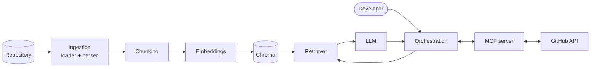

# AI Developer Assistant

An AI developer assistant that combines **Retrieval-Augmented Generation (RAG)** with the
**Model Context Protocol (MCP)** to help engineers understand codebases. It indexes a
repository's code and documentation, answers questions using the retrieved code as
cited context, and helps investigate errors. Through an MCP server it works with GitHub
issues and pull requests, and any write action needs explicit human approval.

> **Status:** Phase 1 (ingestion and chunking) is complete. Phase 2 (embeddings and
> vector search) is in progress.

## Key features (planned)

- **Codebase understanding**: ask questions about a repository and get answers grounded in its code, with file references.
- **Documentation search**: semantic search across Markdown, text, config files and PDFs.
- **Error investigation**: paste a stack trace and get the relevant code paths and likely causes.
- **GitHub workflows**: read issues and pull requests through an MCP server; draft new issues for human review.
- **Safe by design**: read-only by default, no code execution, secrets filtered out before indexing.

## Roadmap

| Phase | Scope | Status |
|---|---|---|
| 1 | Ingestion & chunking | ✅ Done |
| 2 | Embeddings & vector search | 🚧 In progress |
| 3 | RAG question answering | Planned |
| 4 | MCP server | Planned |
| 5 | GitHub integration | Planned |
| 6 | RAG + MCP orchestration | Planned |
| 7 | Human-approved issue creation | Planned |
| 8 | Evaluation, security & documentation | Planned |

## Architecture

A repository goes through an ingestion pipeline that discovers safe files, parses them
and splits them into chunks. The chunks are embedded and stored in Chroma. At question
time the retriever finds the most relevant chunks, and the LLM answers using only that
context. An orchestration layer decides when to use retrieval and when to call GitHub
tools, which are exposed by an MCP server.



See [docs/architecture.md](docs/architecture.md) for the detailed design.

## Tech stack

- **Python 3.11+**, managed with [uv](https://docs.astral.sh/uv/)
- **pydantic / pydantic-settings**: data models and configuration
- **PyMuPDF**: PDF text extraction
- **PyYAML**: safe YAML validation
- **pytest**: tests
- Planned: **Chroma** (vector store), **sentence-transformers** (embeddings), an LLM API, the **MCP** Python SDK, **Streamlit** (UI)

## Getting started

### Setup

```bash
# Install uv (pick one)
curl -LsSf https://astral.sh/uv/install.sh | sh   # official installer
sudo pacman -S uv                                   # Arch Linux
brew install uv                                     # macOS

# Clone and install the locked dependencies
git clone https://github.com/AbdullahThweib2004/ai-developer-assistant.git
cd ai-developer-assistant
uv sync
```

### Configuration

Settings are read from environment variables or a `.env` file. Start from the template:

```bash
cp .env.example .env
```

| Variable | Default | Meaning |
|---|---|---|
| `PROJECT_ROOT` | `.` | Repository to index (`--path` overrides it) |
| `CHUNK_SIZE` | `1000` | Max characters per chunk |
| `CHUNK_OVERLAP` | `150` | Characters shared by consecutive chunks (must be `< CHUNK_SIZE`) |
| `MAX_FILE_SIZE_MB` | `2` | Larger files are skipped |
| `SUPPORTED_EXTENSIONS` | `.md .txt .py .json .yaml .yml .pdf` | JSON array to override |
| `EXCLUDED_DIRS` | `.git`, `.venv`, `node_modules`, `*.egg-info`, ... | Directory names or globs |
| `EXCLUDED_FILE_PATTERNS` | `.env`, `.env.*`, `*.pem`, `*.key`, `id_rsa*`, `*secret*`, `*credentials*`, `*.p12` | Sensitive files that are never read |

### Run the CLI

```bash
# Ingest a repository and print a summary
uv run python -m app.cli ingest --path ./some/repo

# Write every chunk to a JSONL file
uv run python -m app.cli ingest --path ./some/repo --output chunks.jsonl

# Show why each file was skipped
uv run python -m app.cli ingest --path ./some/repo -v
```

Example output:

```
Files found (eligible):  5
Skipped:                 3
  - excluded_dir           2
  - sensitive              1
Documents parsed:        5
Total chunks:            5
  - env                    1
  - json                   1
  - md                     1
  - py                     1
  - yaml                   1
```

### Run the tests

```bash
uv run pytest
```

## Project structure

```
ai-developer-assistant/
├── app/
│   ├── config.py               # settings (pydantic-settings, .env)
│   ├── cli.py                  # command-line interface
│   └── ingestion/
│       ├── models.py           # Document, Chunk, SkippedFile, SkipReason
│       ├── file_loader.py      # safe file discovery
│       ├── document_parser.py  # text / PDF / JSON / YAML parsing
│       ├── chunker.py          # Chunker protocol + CharacterChunker
│       └── pipeline.py         # discover -> parse -> chunk
├── tests/
│   ├── fixtures/sample_project/  # small fake repository used by tests
│   └── test_*.py
├── docs/
│   └── architecture.md
├── .env.example
├── pyproject.toml
└── uv.lock
```

## Security principles

- **Read-only by default.** The assistant reads repositories and GitHub data. It does not modify them unless a write action is explicitly approved.
- **No code execution.** Indexed project code is never imported, executed or evaluated. YAML and JSON are only validated with safe parsers.
- **Secrets never leave the machine.** `.env` files, keys, certificates and credential files are skipped before they are read, and are never logged or indexed. Secrets are never committed to this repository.
- **Human approval for write actions.** Creating issues, comments or pull requests always needs explicit confirmation from the user.
- **Retrieved content is untrusted.** Text from indexed files or GitHub is treated as data, never as instructions, to guard against prompt injection.
- **Path containment.** Every file path is resolved and must stay inside the project root, so `../` paths and symlinks pointing outside are rejected.

## License

Released under the [MIT License](LICENSE).
