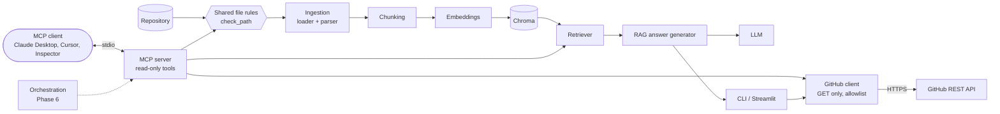

# AI Developer Assistant

An AI developer assistant that combines **Retrieval-Augmented Generation (RAG)** with the
**Model Context Protocol (MCP)** to help engineers understand codebases. It indexes a
repository's code and documentation, answers questions using the retrieved code as
cited context, and helps investigate errors. Through an MCP server it works with GitHub
issues and pull requests, and any write action needs explicit human approval.

> **Status:** Phases 1–5 are complete. You can index a repository and ask cited
> questions from the CLI or a Streamlit UI. Any MCP client (Claude Desktop, Cursor,
> MCP Inspector) can search and read indexed projects and look up GitHub repositories,
> issues and pull requests through a read-only MCP server. Phase 6 (RAG + MCP
> orchestration) is next.

## Key features (planned)

- **Codebase understanding**: ask questions about a repository and get answers grounded in its code, with file references.
- **Documentation search**: semantic search across Markdown, text, config files and PDFs.
- **Error investigation**: paste a stack trace and get the relevant code paths and likely causes.
- **GitHub workflows**: read issues and pull requests through an MCP server; draft new issues for human review.
- **Safe by design**: read-only by default, no code execution, secrets filtered out before indexing.

## Roadmap

| Phase | Scope | Status |
|---|---|---|
| 1 | Ingestion & chunking | ✅ Done |
| 2 | Embeddings & vector search | ✅ Done |
| 3 | RAG question answering | ✅ Done |
| 4 | MCP server | ✅ Done |
| 5 | GitHub integration (read-only) | ✅ Done |
| 6 | RAG + MCP orchestration | ⏭️ Next |
| 7 | Human-approved issue creation | Planned |
| 8 | Evaluation, security & documentation | Planned |

## Architecture

A repository goes through an ingestion pipeline that discovers safe files, parses them
and splits them into chunks. The chunks are embedded and stored in Chroma. At question
time the retriever finds the most relevant chunks, and the LLM answers using only that
context, with citations. The same retrieval and file-access code is exposed to external
MCP clients through a read-only MCP server. One shared set of file rules
(`FileLoader.check_path`) decides what both ingestion and the MCP server may read. A
GET-only GitHub client gives the CLI and the MCP server access to issues and pull
requests on an allowlist of repositories. An orchestration layer comes next.



See [docs/architecture.md](docs/architecture.md) for the detailed design.

## Tech stack

- **Python 3.11+**, managed with [uv](https://docs.astral.sh/uv/)
- **pydantic / pydantic-settings**: data models and configuration
- **PyMuPDF**: PDF text extraction
- **PyYAML**: safe YAML validation
- **sentence-transformers** (`all-MiniLM-L6-v2`): local embeddings
- **Chroma**: persistent vector store (cosine similarity)
- **Anthropic** and **OpenAI** Python SDKs: LLM providers (the OpenAI SDK also covers Groq, OpenRouter and Ollama)
- **Streamlit**: web UI
- **pathspec**: `.gitignore` matching
- **pytest**: tests
- **MCP Python SDK** (`mcp`): MCP server and test client
- **httpx**: GitHub REST client (no GitHub wrapper library)

## Getting started

### Setup

```bash
# Install uv (pick one)
curl -LsSf https://astral.sh/uv/install.sh | sh   # official installer
sudo pacman -S uv                                   # Arch Linux
brew install uv                                     # macOS

# Clone and install the locked dependencies
git clone https://github.com/AbdullahThweib2004/ai-developer-assistant.git
cd ai-developer-assistant
uv sync
```

### Configuration

To keep files out of the assistant's index without touching git, add a
`.assistantignore` at the project root (same syntax as `.gitignore`, e.g. `docs/drafts/`
or `*.generated.py`). Matching files are skipped with the reason `assistantignored`.

Settings are read from environment variables or a `.env` file. Start from the template:

```bash
cp .env.example .env
```

| Variable | Default | Meaning |
|---|---|---|
| `PROJECT_ROOT` | `.` | Repository to index (`--path` overrides it) |
| `CHUNK_SIZE` | `1000` | Max characters per chunk |
| `CHUNK_OVERLAP` | `150` | Characters shared by consecutive chunks (must be `< CHUNK_SIZE`) |
| `MAX_FILE_SIZE_MB` | `2` | Larger files are skipped |
| `SUPPORTED_EXTENSIONS` | `.md .txt .py .json .yaml .yml .pdf` | JSON array to override |
| `EXCLUDED_DIRS` | `.git`, `.venv`, `node_modules`, `*.egg-info`, ... | Directory names or globs |
| `EXCLUDED_FILE_PATTERNS` | `.env`, `.env.*`, `*.pem`, `*.key`, `id_rsa*`, `*secret*`, `*credentials*`, `*.p12` | Sensitive files that are never read |
| `EMBEDDING_PROVIDER` | `sentence_transformers` | Embedding backend (`fake` is for tests only) |
| `EMBEDDING_MODEL` | `sentence-transformers/all-MiniLM-L6-v2` | Model name; stored with the index |
| `EMBEDDING_BATCH_SIZE` | `32` | Chunks embedded per batch |
| `CHROMA_PERSIST_DIR` | `./chroma_db` | Where the vector index is stored (gitignored) |
| `CHROMA_COLLECTION_PREFIX` | `project` | Collections are named `<prefix>_<folder_name>_<path_hash>` |
| `RETRIEVAL_TOP_K` | `5` | Default number of search results |
| `RETRIEVAL_MIN_SCORE` | `0.0` | Minimum similarity (0–1) for a result |
| `LLM_PROVIDER` | `anthropic` | `anthropic`, `openai_compatible`, or `fake` (tests only) |
| `LLM_MODEL` | *(none)* | Required unless the provider is `fake` |
| `LLM_BASE_URL` | *(none)* | For `openai_compatible` servers other than OpenAI |
| `ANTHROPIC_API_KEY` / `OPENAI_API_KEY` | *(none)* | API keys; never logged or printed |
| `LLM_MAX_OUTPUT_TOKENS` | `1024` | Max tokens per answer |
| `LLM_TEMPERATURE` | `0.1` | `none` omits it (always omitted for Anthropic) |
| `LLM_TIMEOUT_SECONDS` | `60` | Per-request timeout |
| `RAG_MAX_CONTEXT_CHARS` | `12000` | Max characters of sources sent to the LLM |
| `MCP_ALLOWED_PROJECT_ROOTS` | *(empty)* | Comma-separated absolute paths the MCP server may read; empty = server won't start |
| `MCP_MAX_FILE_CHARS` | `20000` | Max characters returned by `read_project_file` |
| `MCP_MAX_TOP_K` | `10` | Max `top_k` for the MCP `search_project` tool |
| `GITHUB_TOKEN` | *(none)* | Optional fine-grained read-only token (higher rate limits, private repos) |
| `GITHUB_DEFAULT_REPO` | *(none)* | `owner/name` used when no repo is given |
| `GITHUB_ALLOWED_REPOS` | *(empty)* | Comma-separated allowlist; empty = only the default repo |
| `GITHUB_API_URL`, `GITHUB_TIMEOUT_SECONDS`, `GITHUB_MAX_RESULTS`, `GITHUB_MAX_PAGES`, `GITHUB_MAX_BODY_CHARS`, `GITHUB_MAX_COMMENTS` | see [docs/github.md](docs/github.md) | Limits for GitHub requests and output |

### LLM provider setup

Set one of the following in `.env`. Only the matching key is needed.

**Anthropic (Claude)**

```bash
LLM_PROVIDER=anthropic
LLM_MODEL=claude-opus-5-5
ANTHROPIC_API_KEY=...            # from console.anthropic.com
LLM_MAX_OUTPUT_TOKENS=4096       # current Claude models think before answering; 1024 can be too small
```

**OpenAI**

```bash
LLM_PROVIDER=openai_compatible
LLM_MODEL=gpt-5.5
OPENAI_API_KEY=...
LLM_TEMPERATURE=none             # reasoning models may reject a custom temperature
```

**OpenAI-compatible servers** (Groq, OpenRouter, a local Ollama, ...)

```bash
LLM_PROVIDER=openai_compatible
LLM_BASE_URL=http://localhost:11434/v1   # Ollama; Groq: https://api.groq.com/openai/v1, OpenRouter: https://openrouter.ai/api/v1
LLM_MODEL=llama3.2                       # a model available on that server
OPENAI_API_KEY=...                       # the server's key (Groq/OpenRouter); not needed for Ollama
```

With Ollama, the code you ask about never leaves your machine.

### Run the CLI

**Ingestion** (no embeddings, quick to run):

```bash
# Ingest a repository and print a summary
uv run python -m app.cli ingest --path ./some/repo

# Write every chunk to a JSONL file
uv run python -m app.cli ingest --path ./some/repo --output chunks.jsonl

# Show why each file was skipped
uv run python -m app.cli ingest --path ./some/repo -v
```

Example output:

```
Files found (eligible):  5
Skipped:                 3
  - excluded_dir           2
  - sensitive              1
Documents parsed:        5
Total chunks:            5
  - env                    1
  - json                   1
  - md                     1
  - py                     1
  - yaml                   1
```

**Indexing and search** (the embedding model is downloaded on first use):

```bash
# Embed a repository into Chroma (use --rebuild to replace an existing index)
uv run python -m app.cli index --path ./some/repo --rebuild

# Semantic search: rank, score, file, chunk and a preview
uv run python -m app.cli search --path ./some/repo "How are passwords verified?" --top-k 5
uv run python -m app.cli search --path ./some/repo "database settings" --type yaml

# What is indexed for a repository
uv run python -m app.cli stats --path ./some/repo
```

> **Upgrading from an earlier version:** collection names now include a hash of the
> repository's absolute path (`project_<folder>_<hash8>`). Indexes created before
> this change are not found under the new name. Re-run `index --path <repo> --rebuild`
> once per repository, then optionally delete the old `chroma_db/` directory.

Example search output:

```
1. [0.621] app/ingestion/chunker.py (chunk 2)
   his means the progress rule is broken. max_iterations = length + 1 while start < length: ...
```

**Ask questions** (needs an indexed project and an LLM provider):

```bash
uv run python -m app.cli ask --path ./some/repo "How are passwords verified?"
uv run python -m app.cli ask --path ./some/repo "Why would login fail?" --top-k 8 --type py --show-sources
```

`ask` prints the answer, the cited sources with file paths and character ranges,
token usage and latency. The answer is split into **From the project** (cited facts),
**General knowledge** and **Hypotheses**. If no source passes `RETRIEVAL_MIN_SCORE`,
no LLM call is made and you get an *insufficient evidence* answer with suggestions.
The LLM can also flag insufficient evidence itself. Citations that don't match a
provided source (e.g. `[S9]` when only S1–S5 were sent) are listed as invalid
citations, not hidden.

### Web UI

```bash
uv run streamlit run app/ui/streamlit_app.py
```

The sidebar has the project path, an **Index / Rebuild** button with the indexing
report, index stats, `top_k`, a file-type filter and the active provider/model (never
keys). The main area shows the answer, the cited sources and expandable panels with
each retrieved chunk and its score. The UI calls the same answer generator as the CLI.
It only listens on `localhost` (see `.streamlit/config.toml`).

#### Screenshots

> _Screenshots of the UI will be added here._
>
> `docs/images/ui-answer.png`: an answer with cited sources
> `docs/images/ui-insufficient.png`: an insufficient-evidence answer

### MCP server

The read-only project tools are also available to any MCP client over stdio:
`ping`, `get_index_stats`, `search_project`, `read_project_file` and
`list_project_files`.

```bash
uv run python -m app.cli index --path /absolute/path/to/project --rebuild
MCP_ALLOWED_PROJECT_ROOTS=/absolute/path/to/projects uv run python -m app.mcp_server

# Smoke test: lists tools, calls ping and search_project on this repository
uv run python scripts/mcp_smoke_test.py
```

The server only works on projects inside `MCP_ALLOWED_PROJECT_ROOTS`. It applies the
same file rules as ingestion (no secrets, ignored files, binaries or paths outside
the project), wraps all returned file text as untrusted content, and never writes,
executes code or calls an LLM. See **[docs/mcp.md](docs/mcp.md)** for tool schemas,
the security model, and setup for MCP Inspector, Claude Desktop and Cursor.

### GitHub (read-only)

Look up repositories, issues and pull requests. This works without a token for
public repositories, and uses `GITHUB_TOKEN` automatically when it's set.

```bash
export GITHUB_ALLOWED_REPOS=fastapi/fastapi    # or set it (and GITHUB_DEFAULT_REPO) in .env
uv run python -m app.cli github repo --repo fastapi/fastapi
uv run python -m app.cli github search "401 unauthorized bearer token" --repo fastapi/fastapi --kind any
uv run python -m app.cli github issue 10177 --repo fastapi/fastapi
uv run python -m app.cli github prs --repo fastapi/fastapi --state closed
uv run python -m app.cli github pr 16476 --repo fastapi/fastapi
```

Each command ends with the remaining rate limit. The same client powers five MCP
tools (`get_github_repository`, `search_github_issues`, `get_github_issue`,
`list_github_pull_requests`, `get_github_pull_request`). Nothing is ever written to
GitHub. See **[docs/github.md](docs/github.md)** for token setup (minimum
permissions), the allowlist, rate limits and the security model.

### Run the tests

```bash
uv run pytest            # fast suite: fake embeddings, fake LLM, temp Chroma dirs, no network
uv run pytest -m slow    # also runs the real embedding model and, if configured, the real LLM
```

### Evaluate retrieval

```bash
uv run python evaluation/evaluate_retrieval.py
```

This indexes `tests/fixtures/sample_project` with the configured model and runs the
questions in [`evaluation/questions.json`](evaluation/questions.json). It reports
file-level Precision@5, Recall@5 and MRR and saves the results to
`evaluation/results/` (gitignored).

**Baseline** (`all-MiniLM-L6-v2`, chunk size 1000 / overlap 150, 12 questions, 8 files):

| Metric | Score |
|---|---|
| Precision@5 | 0.250 |
| Recall@5 | 1.000 |
| MRR | 0.958 |

Each question has only 1–2 relevant files, so Precision@5 can't go above 0.2–0.4.
The fixture is small, so these numbers are a regression baseline, not a measure of
real-world quality.

[`evaluation/questions_self.json`](evaluation/questions_self.json) contains questions
about this repository, including a known hard case for vector-only search (it
finds `embeddings.py` instead of `vector_store.py`). It is kept for evaluating
hybrid search later:

```bash
uv run python evaluation/evaluate_retrieval.py --path . --questions evaluation/questions_self.json
```

Self-repo baseline (15 questions covering ingestion, retrieval, RAG, LLM providers and
MCP; 61 files; `evaluation/` excluded via `.assistantignore`): **Precision@5 0.187,
Recall@5 0.867, MRR 0.549**. `s01` (the hard case) is still the only complete miss. In
this documentation-heavy repository, `docs/architecture.md` often ranks above the code it
describes. That is a good motivation for hybrid search or reranking later.

### Evaluate answers

```bash
uv run python evaluation/evaluate_answers.py
```

Requires a real LLM provider (the script exits with a message otherwise). It
indexes the fixture project and asks the 12 questions in
[`evaluation/answer_questions.json`](evaluation/answer_questions.json). 8 are
answerable and 4 can't be answered from the project. Each answer gets these
automatic checks:

- cites at least one expected file
- has no invalid citations
- mentions the required key terms
- flags insufficient evidence only when it should

Results and a Markdown sheet for manual scoring (correctness and groundedness,
1–5) are written to `evaluation/results/` (gitignored).

**Baseline:** *pending: requires an LLM provider.* The commands to run are listed in
[docs/pending_llm_checks.md](docs/pending_llm_checks.md).

## Project structure

```
ai-developer-assistant/
├── app/
│   ├── config.py               # settings (pydantic-settings, .env)
│   ├── cli.py                  # command-line interface (ingest, index, search, stats, ask)
│   ├── ingestion/
│   │   ├── models.py           # Document, Chunk, SkippedFile, SkipReason
│   │   ├── file_loader.py      # safe file discovery
│   │   ├── document_parser.py  # text / PDF / JSON / YAML parsing
│   │   ├── chunker.py          # Chunker protocol + CharacterChunker
│   │   └── pipeline.py         # discover -> parse -> chunk
│   ├── retrieval/
│   │   ├── embeddings.py       # EmbeddingProvider protocol, sentence-transformers, fake
│   │   ├── vector_store.py     # Chroma wrapper (one collection per project)
│   │   ├── indexer.py          # pipeline -> embeddings -> Chroma
│   │   └── retriever.py        # query -> ranked chunks
│   ├── llm/
│   │   ├── base.py             # LLMProvider protocol, LLMResponse, errors, retry
│   │   ├── anthropic_provider.py
│   │   ├── openai_compatible.py  # OpenAI, Groq, OpenRouter, Ollama, ...
│   │   ├── fake_provider.py    # deterministic, for tests
│   │   └── factory.py
│   ├── rag/
│   │   ├── prompts.py          # system prompt (versioned)
│   │   ├── context_builder.py  # dedup, budget, numbered <source> blocks
│   │   └── answer_generator.py # retrieve -> context -> LLM -> validate citations
│   ├── ui/
│   │   └── streamlit_app.py
│   ├── mcp_server/
│   │   ├── server.py           # MCPServer + tool registration (stdio)
│   │   ├── schemas.py          # tool input types and output models
│   │   ├── security.py         # allowed roots, file checks, untrusted wrapping
│   │   ├── errors.py           # internal errors -> safe tool errors
│   │   └── tools/
│   │       ├── project_tools.py  # thin wrappers over retrieval/ingestion
│   │       └── github_tools.py   # GitHub tools: allowlist + untrusted wrapping
│   └── integrations/
│       ├── github_client.py    # GET-only httpx client: pagination, rate limits, retries
│       ├── github_models.py    # normalized repository/issue/PR models
│       └── github_errors.py
├── scripts/
│   └── mcp_smoke_test.py       # stdio client: list tools, ping, search
├── evaluation/
│   ├── questions.json          # retrieval questions (fixture project)
│   ├── questions_self.json     # retrieval questions (this repository)
│   ├── evaluate_retrieval.py   # Precision@k, Recall@k, MRR
│   ├── answer_questions.json   # answerable + unanswerable questions
│   └── evaluate_answers.py     # automatic answer checks + review sheet
├── tests/
│   ├── fixtures/sample_project/  # small fake repository used by tests
│   └── test_*.py
├── docs/
│   ├── architecture.md
│   ├── mcp.md                  # MCP tools, security model, client setup
│   ├── github.md               # GitHub token, allowlist, rate limits, tools
│   └── pending_llm_checks.md   # checks to run once an LLM key is set
├── .env.example
├── pyproject.toml
└── uv.lock
```

## Security principles

- **Read-only by default.** The assistant reads repositories and GitHub data. It does not modify them unless a write action is explicitly approved.
- **No code execution.** Indexed project code is never imported, executed or evaluated. YAML and JSON are only validated with safe parsers.
- **Secrets stay out of the index.** `.env` files, keys, certificates and credential files are skipped before they are read, and are never logged or indexed. API keys are held as secret values and never logged or printed. Secrets are never committed to this repository.
- **Know where your code goes.** Answering a question sends the retrieved chunks to the configured LLM provider. Use a local Ollama model if the code must not leave your machine. Prompts, retrieved code and answers are never written to logs.
- **Human approval for write actions.** Creating issues, comments or pull requests always needs explicit confirmation from the user.
- **Retrieved content is untrusted.** Text from indexed files or GitHub is treated as data, never as instructions. Sources are wrapped in `<source>` tags, tag-like text inside them is escaped, and the system prompt tells the model to ignore instructions found in sources.
- **Citations are verified.** Every `[Sx]` in an answer is checked against the sources actually sent, and unknown citations are reported.
- **Respects `.assistantignore`.** An optional `.assistantignore` at the project root (same syntax as `.gitignore`) excludes files from the assistant only, without changing git. This repository uses it to keep `evaluation/` out of its own index.
- **Respects `.gitignore`.** Files ignored by the repository's `.gitignore` files (root and nested, including `!` negations) are not indexed. Built-in exclusions still apply to repositories without a `.gitignore`.
- **MCP is read-only and sandboxed to allowed roots.** MCP tools only work inside `MCP_ALLOWED_PROJECT_ROOTS`, reuse the ingestion file rules, cap output sizes, and return errors without absolute paths, stack traces or secrets.
- **GitHub is read-only and allowlisted.** The GitHub client can only send GET requests, only to allowlisted repositories, and never sends the token anywhere except the API host. Issue and PR text is treated as untrusted content.
- **Path containment.** Every file path is resolved and must stay inside the project root, so `../` paths and symlinks pointing outside are rejected.

## License

Released under the [MIT License](LICENSE).
