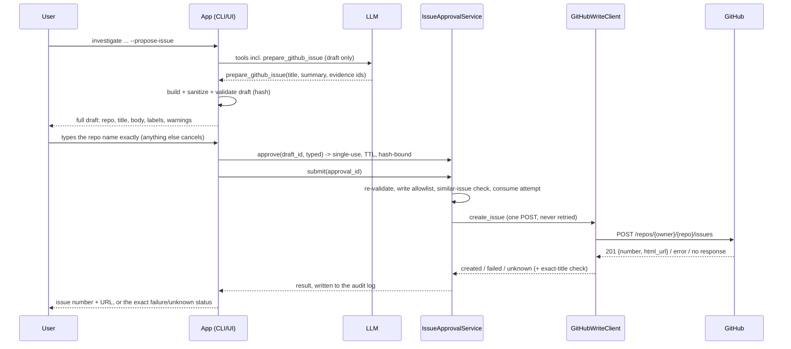

# Human-approved GitHub issue creation (Phase 7)

Creating an issue is the first **write** operation in the project. The design goal is
simple to state: **the LLM can only draft; a human approves; the app writes.**

## Threat model

| Threat | Mitigation |
|---|---|
| The model decides to write on its own, or is talked into it by text in code, docs or issues ("create the issue now") | The model has no create, submit or approve tool. Its only action tool, `prepare_github_issue`, builds a draft and returns a draft id. It exists only when the user explicitly asked for an issue (`--propose-issue` / "Prepare GitHub issue"). Creation is app code that runs after a human approves. |
| Approving one thing and creating another (edits, tampering) | Approvals are bound to `draft_hash` = sha256(repo, title, body, labels). Any edit changes the hash, voids the approval, and requires a new one. `submit` recomputes the hash before writing. |
| Replay / double submission (double click, repeated command) | An approval is single-use and expires (`APPROVAL_TTL_SECONDS`, default 600). A draft gets **at most one** creation attempt; its approval and attempt are consumed *before* the request is sent. |
| Writing to the wrong repository | A separate write allowlist, `GITHUB_WRITE_ALLOWED_REPOS`; the read allowlist grants nothing. The human must type the destination repo name exactly. The write client checks the allowlist again. |
| Leaking secrets into a public issue | Drafts are secret-scanned on creation, after every edit, and right before submitting: `sk-…` keys, GitHub tokens, AWS keys, private key blocks, Slack tokens, JWTs, secret-like `KEY=value` lines, and long high-entropy strings. A hit blocks approval. Only the *kind* is shown, never the value. |
| Leaking local information | Absolute project paths become project-relative, and other home/tmp paths are redacted to `<local-path>/name`. Internal citation ids become file paths or `owner/repo#N`. |
| Side effects on other people or issues | `@mentions` are wrapped in backticks (no notifications). Closing keywords (`fixes #12`) are rewritten to `related to #12`. Labels are optional and validated. |
| Misattribution | Tool/AI credit lines are removed, and the body template contains none. Issues are authored by the token owner. |
| Mixing credentials | `GITHUB_WRITE_TOKEN` is used only by the write client. Reads, including the post-failure check, use the read client (`GITHUB_TOKEN` or no token). Neither client ever holds the other token. |
| A broken write client doing more than intended | `GitHubWriteClient` is a separate class with one operation. Its request hook allows only `POST /repos/{owner}/{repo}/issues` on the configured API host and refuses everything else before sending. The read client stays GET-only. |
| Duplicate issues after timeouts | POSTs are **never retried**. On a timeout, connection error, 5xx or malformed 201, the outcome is **unknown**: the client lists the repo's newest issues (no search-index delay) and reports any with the exact same title created in the last few minutes. Success is reported only for HTTP 201 with an issue number and URL. |
| Duplicate issues in general | Before submitting, open issues with a very similar title (≥ 80% similar) are shown, and a second explicit confirmation is required. |
| No record of what happened | An append-only JSONL audit log (`AUDIT_LOG_PATH`, gitignored) records `approved` / `cancelled` / `created` / `failed` / `unknown` / `blocked` with the timestamp, repo, draft hash, title length, channel, issue number and URL, and error category. It never stores the body, the title text or a token. |
| External MCP clients writing silently | The MCP `create_github_issue` tool exists only when `MCP_ENABLE_WRITE_TOOLS=true` and writing is configured. It requires MCP **elicitation**: the user sees the exact repo, title and body and must type the repo name. With no elicitation support, or on decline or cancel, nothing is created. Our own orchestrator never shows this tool to its LLM. |

## The flow



### Draft (`app/actions/issue_draft.py`)

`IssueDraft` holds:
- `repo`, `title`, `body`, `labels`
- `source_question`, `evidence` (S/G references with file paths and issue URLs)
- `created_at`, `draft_hash`
- `errors` (these block approval) and `warnings` (notes about what was changed)

The body template has these sections: **Summary**, **Steps to reproduce**, **Expected
behavior**, **Actual behavior**, **Error messages**, **Relevant files** (relative
paths), **Related issues/PRs (leads, not confirmed)** (quoted, linked), and **Proposed
investigation steps**.

Validation rules:
- repo in the write allowlist
- title 1–256 characters, no newlines
- body ≤ 65,536 characters
- at most 10 labels, each 1–50 characters with no commas
- no secrets

### Approval (`app/actions/approval.py`)

`IssueApprovalService` is app code. It is never a tool.

- `approve(draft_id, typed)`: the typed text must equal the repo exactly, otherwise it
  cancels and writes to the audit log. The draft must be valid and writing must be
  enabled. Returns a single-use `Approval` with an expiry.
- `edit_draft(...)`: re-validates and changes the hash, which voids earlier approvals.
- `submit(approval_id, confirm_similar=False)`:
  1. Check that the approval exists, is unused, is unexpired, and that its hash
     matches the draft.
  2. Check that the draft hasn't been attempted yet.
  3. Re-validate the draft and check the write allowlist.
  4. Run the similar-issue check; `needs_confirmation` stops here unless confirmed.
  5. Consume the approval and the attempt.
  6. Send one POST.
  7. Write the audit record.

### CLI

```bash
uv run python -m app.cli investigate --path examples/fastapi-auth-demo --mode project --propose-issue \
  "Why do requests to /users/me return 401 even though I send a valid bearer token? Please propose a GitHub issue."
uv run python -m app.cli github draft-issue --repo OWNER/SANDBOX --title "..." --body-file body.md
```

The full draft is printed. **Type the repository name** to create the issue; any other
input cancels. If similar issues exist, you must also type `create anyway`. There is
no `--yes` or auto-approve option. If the model prepared no draft, the CLI asks
whether to build one from the answer.

### Web app

After an investigation (see [web.md](web.md) for the API):
1. Click **Prepare GitHub issue**. This opens a drawer with the destination repo at the
   top, an editable title, body (with live preview) and labels, notes and errors, and
   any similar open issues.
2. Edits are saved to the server, which re-validates the draft, computes a new hash and
   voids any earlier approval. Any edit also clears the typed confirmation.
3. **Approve and create** stays disabled while the draft has errors or unsaved edits,
   the typed repo name doesn't match exactly, or similar issues haven't been
   acknowledged. The server checks all of this again: the approve request carries the
   draft hash the user reviewed and the typed repo name, and goes through the same
   `IssueApprovalService.approve` + `submit` as the CLI.

After the single attempt, the button is gone. The UI shows the issue number and link
only on a confirmed 201; otherwise it shows the error or the unknown outcome and any
possible matches. When writing is disabled or not configured, the UI says so.

### MCP elicitation

`create_github_issue(repo, title, body)` takes a confirmation parameter that is
injected by a resolver (`Resolve` + `Elicit` from the MCP Python SDK v2). The resolver
validates the draft (a secret blocks it before anything is shown) and asks the user
through elicitation.

The SDK delivers that question in whatever way the session supports: input-required
rounds on protocol `2026-07-28`, or a server-to-client request on older versions. A
client without the elicitation capability gets a "missing capability" error, and the
tool body (the only code that writes) never runs. The model can't supply the
confirmation, because it isn't part of the tool's input schema.

## Configuration

| Variable | Default | Meaning |
|---|---|---|
| `GITHUB_WRITE_TOKEN` | *(none)* | Fine-grained token with **Issues: Read and write** on the write repos only |
| `GITHUB_WRITE_ENABLED` | `false` | Master switch |
| `GITHUB_WRITE_ALLOWED_REPOS` | *(empty)* | The only writable repositories |
| `APPROVAL_TTL_SECONDS` | `600` | Approval lifetime (30–3600) |
| `MCP_ENABLE_WRITE_TOOLS` | `false` | Expose `create_github_issue` to external MCP clients |
| `AUDIT_LOG_PATH` | `./audit/github_writes.jsonl` | Audit log (gitignored) |

See [github.md](github.md) for creating the write token.

## Limitations

- The secret scanner uses patterns and an entropy heuristic. It catches common key and
  token formats, not every possible secret, so the human review is the real control.
- An external MCP client's "confirmation" is only as trustworthy as that client's UI.
  Elicitation is meant for a human, but an MCP host could auto-answer it. Keep
  `MCP_ENABLE_WRITE_TOOLS=false` unless you trust the client.
- Drafts and approvals live in the CLI process or the browser session (in memory). The
  audit log is the persistent record.
- The similar-issue check looks at up to the 100 most recently updated open issues.
